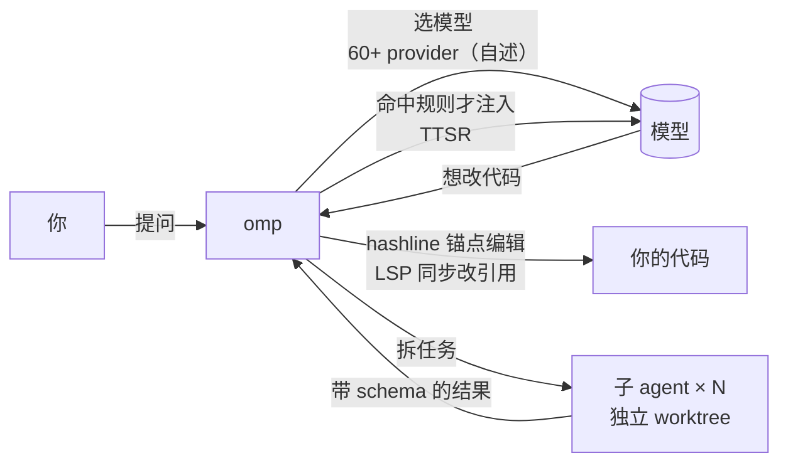
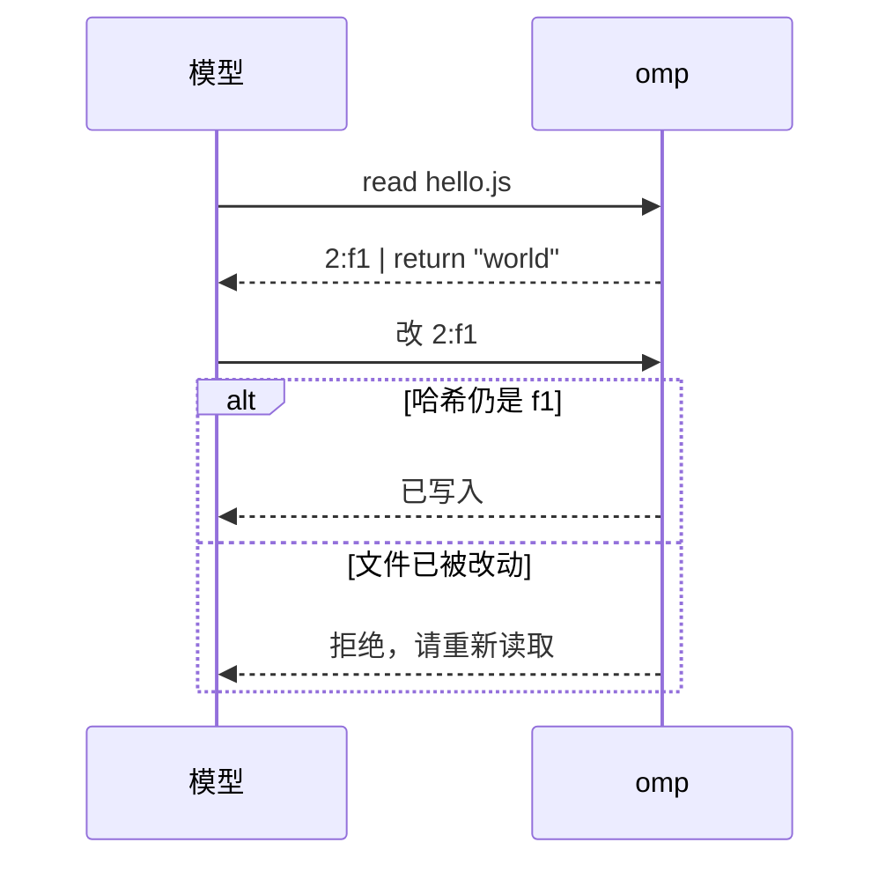

# Awesome omp (oh-my-pi)

[English](README.en.md) | 中文

> 把 **omp**（[can1357/oh-my-pi](https://github.com/can1357/oh-my-pi)）讲透的深研清单：先弄懂它的机制，再看逐条核实过的生态和 Pi 兼容性。给人读，也给 AI agent 当上下文。

**omp 是什么**：一个终端里的 AI coding agent，从 [Pi](https://github.com/earendil-works/pi) 分叉而来，把 LSP、调试器、语法级编辑和大量工具直接接进 agent。
**不是**：oh-my-posh（它的主题文件叫 `*.omp.json`）、npm 上的 `oh-my-pi` 包、OpenMP。

> [!WARNING]
> **打开陌生仓库前先看这里。** omp 按设计会加载项目里的 settings、extensions、hooks、tools、commands、skills、rules 和项目 MCP 配置，扩展是在你机器上运行的任意代码。用 `--no-extensions` 跳过扩展自动发现，用 `--trusted-extension /绝对路径.ts` 只放行指定扩展，用 `--config <file>` 关掉项目 `.mcp.json`。（[官方 README「Project inputs and trust」](https://github.com/can1357/oh-my-pi/blob/main/README.md#project-inputs-and-trust)，核实于 2026-10-21；详见 [信任与安全](docs/practice.md#信任与安全)）

<!-- BEGIN GENERATED: stats -->共 380 条，16 个分类；精选 20 条；常见误解 9 条；兼容矩阵 10 行。其中 omp 官方 9 条，项目声明支持 omp 351 条，Pi 包在 omp 实测加载 1 条。指标抓取于 2026-10-21 11:59（Asia/Shanghai）。<!-- END GENERATED: stats -->

## 目录

- [只看 3 条](#只看-3-条)
- [30 秒看懂 omp](#30-秒看懂-omp)
- [3 分钟上手](#3-分钟上手)
- [核心机制一览](#核心机制一览)
- [精选](#精选)
- [常见误解](#常见误解)
- [社区怎么看](#社区怎么看)
- [来历](#来历)
- [深入阅读](#深入阅读)
- [收录规则](#收录规则)
- [与现有清单的区别](#与现有清单的区别)
- [给 AI agent](#给-ai-agent)
- [声明](#声明)

## 只看 3 条

<!-- BEGIN GENERATED: top3 -->
1. **[omp (can1357/oh-my-pi)](https://github.com/can1357/oh-my-pi)**：一切的源头。README 用 21 节讲清卖点（LSP、调试器、TTSR、子 agent、hashline），docs/ 顶层有 82 篇文档（2026-10-21 主分支），比任何二手介绍都准。
2. **[The harness problem（作者博客）](https://blog.can.ac/2026/02/12/the-harness-problem/)**：读懂 omp 为什么存在：作者认为瓶颈常在 harness 而不是模型，只换编辑格式（hashline）就让多数模型通过率上升。数字是自述基准，配合「常见误解」看。
3. **[The Harness Playbook（Stencil 博客）](https://stencil.so/blog/harness-playbook)**：作者亲自复盘 omp 哪里做错了，并公布替代架构 omp²（扩展改用 Python）。想在 omp 上长期投入扩展开发，先读这篇。
<!-- END GENERATED: top3 -->

## 30 秒看懂 omp



1. **Pi 是极简内核，omp 是全家桶。** 同样能写扩展，但 omp 自带 LSP、调试器、浏览器、子 agent、插件市场。
2. **它押注 harness 而不是模型。** 作者的论点：同一个模型，换编辑格式和工具设计，成功率会差很多（[why.md](docs/why.md)）。
3. **生态和 Pi 部分互通。** Pi 包常常能装上，但目录、API 版本不同，要逐个验证（[兼容矩阵](docs/pi-compat.md)）。

## 3 分钟上手

```sh
# 1. 安装（任选一种）。官方 README 把 Bun 标为 recommended，要求 bun ≥ 1.3.14
bun install -g @oh-my-pi/pi-coding-agent
curl -fsSL https://omp.sh/install | sh      # macOS / Linux
brew install can1357/tap/omp

# 2. 选一个模型：在终端里登录 provider（TUI 里对应 /login）
omp login
#    也可以在 ~/.omp/agent/models.yml 里写自定义或本地 provider

# 3. 启动
omp
```

- 没有默认模型时 omp 会直接退出（「No default model selected」），这是正常行为，不是安装失败。
- Windows（`irm https://omp.sh/install.ps1 | iex`）、Nix、mise、Alpine 的装法见 [practice.md](docs/practice.md#安装)。
- 不想动真实账号：`sh examples/run.sh 18.12.5` 会在临时 HOME 里装好 omp，用一个假 provider 读出命令和工具列表，不调用任何模型（[RUNLOG](examples/RUNLOG.md)）。

命令核对自官方 [README · Install](https://github.com/can1357/oh-my-pi/blob/main/README.md#install) 和 [cli-reference.md](https://github.com/can1357/oh-my-pi/blob/main/docs/cli-reference.md)，2026-10-21，对应 v18.12.5（已验证）。

## 核心机制一览

omp 和其他 coding agent 的差别主要在这五个机制。每条都标了证据类型，细节和源码路径见 [deep-dive](docs/deep-dive.md)。

### 1. hashline：按内容哈希编辑

- **解决什么**：`apply_patch` 要模型写对 diff 格式，`str_replace` 要模型逐字复述旧文本，复述错一个字符就会改坏文件。
- **怎么做**：读文件时每行带一个 2–3 字符的内容哈希，编辑时只引用「行号:哈希」。文件如果已经变了，哈希对不上，编辑会在写入前被拒绝。
- **证据**：机制在源码 `crates/pi-edit` 里可见（已验证）。效果来自作者自己的基准：16 个模型中 14 个优于 patch（自述）。HN 上也有用户反馈，修复坏掉的锚点要多花轮次。→ [deep-dive §3.1](docs/deep-dive.md#31-hashline按内容哈希编辑)



### 2. TTSR：输出命中才注入的规则

- **解决什么**：规则写进系统提示词，每一轮都要占上下文。
- **怎么做**：规则平时不进上下文。模型流式输出一旦命中某条规则的正则，omp 就中断这次请求，把规则作为系统提醒注入，再从同一位置重试。
- **证据**：官方文档和源码 `session/ttsr-coordinator.ts`（已验证）；「注入在压缩后保留」是 README 自述；代价是多一次请求，规则写得太宽会频繁打断（推断）。→ [deep-dive §3.2](docs/deep-dive.md#32-ttsr时间旅行的流式规则)

### 3. 子 agent（task 工具）

- **解决什么**：大任务都塞进一个上下文，会越跑越乱。
- **怎么做**：`task` 工具派生子 agent，各自在隔离的 worktree 里工作，返回经过 schema 校验的结果；父 agent 用 `agent://<id>/...` 内部 URL 按路径取字段。agent 定义来自内置、用户、项目三处，有 spawn 深度限制。
- **证据**：官方 task-agent-discovery.md 和 `src/task/` 源码（已验证）；worktree 隔离与结构化结果来自 README（自述）。→ [deep-dive §3.3](docs/deep-dive.md#33-子-agenttask)

### 4. LSP 与调试器直接接进 agent

- **解决什么**：agent 改名、重构时漏改引用；遇到崩溃只能猜。
- **怎么做**：写文件时走 LSP（例如 `workspace/willRenameFiles`），re-export 和别名一起改；调试时 agent 直接挂 lldb、dlv、debugpy，单步执行、查看栈帧。
- **证据**：README §02、§03（自述）；lsp-config.md 和 `src/dap/` 源码可见（已验证）。→ [deep-dive §2](docs/deep-dive.md#2-有什么用场景)

### 5. 扩展、插件市场与 Pi 兼容

- **解决什么**：内置功能总有不够用的时候，团队手里往往也已经有 Claude Code 或 Pi 的插件和规则。
- **怎么做**：扩展是一个默认导出工厂函数的 TS/JS 模块，可以注册工具、命令、事件和 UI；插件市场直接兼容 Claude Code 插件格式；兼容层把 Pi 的包名导入别名到 omp 自己的包。首次运行还会读取 `.claude`、`.cursor`、`.codex` 等 8 种目录里已有的规则、skills 和 MCP。
- **证据**：extensions.md、marketplace.md、legacy-pi-compat.ts（已验证）；本仓库离线实测，最小扩展、最小插件市场和 Pi 包 pi-web-access 都能加载（实测）；「8 种目录」是 README 自述。→ [deep-dive §3.4](docs/deep-dive.md#34-扩展-api-与插件)、[兼容矩阵](docs/pi-compat.md)

## 精选

按你想做的事分组，每条一句「为什么值得看」。全量登记见 [docs/ecosystem.md](docs/ecosystem.md)。

<!-- BEGIN GENERATED: featured -->
### 想弄懂原理

- **[omp (can1357/oh-my-pi)](https://github.com/can1357/oh-my-pi)**（omp 本体）：一切的源头。README 用 21 节讲清卖点（LSP、调试器、TTSR、子 agent、hashline），docs/ 顶层有 82 篇文档（2026-10-21 主分支），比任何二手介绍都准。 [详情](docs/ecosystem.md#oh-my-pi)
- **[The harness problem（作者博客）](https://blog.can.ac/2026/02/12/the-harness-problem/)**（文章 / 教程 / 讨论）：读懂 omp 为什么存在：作者认为瓶颈常在 harness 而不是模型，只换编辑格式（hashline）就让多数模型通过率上升。数字是自述基准，配合「常见误解」看。 [详情](docs/ecosystem.md#the-harness-problem)
- **[The Harness Playbook（Stencil 博客）](https://stencil.so/blog/harness-playbook)**（文章 / 教程 / 讨论）：作者亲自复盘 omp 哪里做错了，并公布替代架构 omp²（扩展改用 Python）。想在 omp 上长期投入扩展开发，先读这篇。 [详情](docs/ecosystem.md#harness-playbook)
- **[omp 文档：TTSR 注入生命周期](https://github.com/can1357/oh-my-pi/blob/main/docs/ttsr-injection-lifecycle.md)**（官方文档导读）：omp 最独特的机制：规则平时不占上下文，模型输出命中正则才中断流、注入规则并重试。这篇把发现、中断、重试、会话状态一路讲到源码。 [详情](docs/ecosystem.md#docs-ttsr)
- **[omp 文档：子 agent 发现与选择](https://github.com/can1357/oh-my-pi/blob/main/docs/task-agent-discovery.md)**（官方文档导读）：子 agent 是 omp 的主力工作方式。这篇讲清 agent 定义字段、来源优先级、spawn 深度限制，自己写 agent 前必读。 [详情](docs/ecosystem.md#docs-task-agents)

### 想写扩展或接插件

- **[omp 文档：Extensions + Extension loading](https://github.com/can1357/oh-my-pi/blob/main/docs/extensions.md)**（官方文档导读）：写扩展的唯一权威：工厂函数、事件、工具、斜杠命令、UI，以及从哪些目录发现扩展。本仓库的最小扩展照它写成并实测可加载。 [详情](docs/ecosystem.md#docs-extensions)
- **[omp 文档：Marketplace 插件系统](https://github.com/can1357/oh-my-pi/blob/main/docs/marketplace.md)**（官方文档导读）：omp 能直接用 Claude Code 插件市场格式，这是它和 Pi 最大的生态差异。文档讲清作用域、锁文件和刷新规则。 [详情](docs/ecosystem.md#docs-marketplace)
- **[pi-web-access](https://github.com/nicobailon/pi-web-access)**（扩展）：Pi 包在 omp 上能用的实证：装上即有 web_search，但需要 Pi 0.86+ 的动态激活功能自动关闭。拿它当「搬 Pi 包」的参照。 [详情](docs/ecosystem.md#pi-web-access)
- **[anthropics/claude-plugins-official](https://github.com/anthropics/claude-plugins-official)**（插件市场源）：omp 文档官方示例里的插件市场源。一条命令就能把 Claude Code 生态的插件接进 omp，但插件内容是否全部可用要自己验证。 [详情](docs/ecosystem.md#claude-plugins-official)

### 想配模型和工作流

- **[Custom Models in Oh My Pi（doug.sh）](https://doug.sh/posts/oh-my-pi-custom-models/)**（模型与 provider）：跑本地模型最实用的一篇：各推理服务的 models.yml 可用配置、模型角色和白名单，并注明 omp 18.2.7 之后要改的两处。 [详情](docs/ecosystem.md#doug-custom-models)
- **[Magic Context（cortexkit）](https://github.com/cortexkit/magic-context)**（记忆与上下文）：跨会话记忆和上下文管理，安装时自动识别 omp，注册插件并关闭 omp 内置压缩。适合长会话用户，也说明 omp 的压缩可以被替换。 [详情](docs/ecosystem.md#magic-context)
- **[pi-automode](https://github.com/czottmann/pi-automode)**（工作流与多 agent）：给 omp 加类似 Claude Code 的自动审批模式，由一个可选模型判断哪些操作可放行。权限和效率之间的折中，值得对照 omp 自带的 approval-mode 一起看。 [详情](docs/ecosystem.md#pi-automode)
- **[Current Agentic Development Environment：Orca + Oh My Pi](https://james-carr.org/posts/2026-09-30-current-agentic-development-setup-orca-oh-my-pi/)**（文章 / 教程 / 讨论）：讲清 omp 的「模型角色」怎么分工（default、smol、slow、plan 等各用什么模型），是把多模型路由落地的具体样例。 [详情](docs/ecosystem.md#james-carr-orca-omp)

### 想换界面或嵌进自己的工具

- **[gooey-pi](https://github.com/am-will/gooey-pi)**（桌面 / Web / 移动前端）：不想用 TUI 时最受关注的桌面前端之一（Electron，跨平台），同时支持 Pi 和 omp。 [详情](docs/ecosystem.md#gooey-pi)
- **[omp 文档：RPC 与 SDK](https://github.com/can1357/oh-my-pi/blob/main/docs/rpc.md)**（官方文档导读）：把 omp 嵌进自己工具的两条路：Node SDK 和 stdio NDJSON 的 RPC。我们的离线测试就是用 RPC 读命令和工具列表，不调用模型。 [详情](docs/ecosystem.md#docs-rpc-sdk)

### 想看社区评价和选型

- **[Pi（earendil-works/pi，原 badlogic/pi-mono）](https://github.com/earendil-works/pi)**（相邻清单与项目）：omp 的上游。理解「Pi 极简、omp 全家桶」的分工，以及哪些 Pi 包能搬过来（见兼容矩阵）。 [详情](docs/ecosystem.md#earendil-pi)
- **[Hacker News：Oh-my-pi – A coding agent with the IDE wired in](https://news.ycombinator.com/item?id=48994611)**（文章 / 教程 / 讨论）：真实用户的正反声音：上手快、搜索集成好；也有人担心用订阅账号走 OAuth 会被封、质疑跑分。 [详情](docs/ecosystem.md#hn-launch)
- **[Pi vs OMP (Oh My Pi Agent)：Everything You Need to Know（Composio）](https://composio.dev/content/pi-vs-omp)**（文章 / 教程 / 讨论）：少见的 Pi 与 omp 并排对比，适合选型前快速扫一遍。是厂商内容，结论请对照本仓库兼容矩阵。 [详情](docs/ecosystem.md#composio-pi-vs-omp)
- **[thevibeworks/awesome-pi-agent](https://github.com/thevibeworks/awesome-pi-agent)**（相邻清单与项目）：Pi 生态人工策展清单，omp 只占一节。想看 omp 之外的 Pi 扩展、分支和前端，去那里。 [详情](docs/ecosystem.md#thevibeworks-awesome-pi-agent)

### 中文读者

- **[omp-docs-cn（非官方中文文档站）](https://github.com/Aieguu/omp-docs-cn)**（中文社区）：中文读者的入口。非官方，更新可能落后于上游，遇到出入以英文 docs/ 为准。 [详情](docs/ecosystem.md#omp-docs-cn)
<!-- END GENERATED: featured -->

## 常见误解

<!-- BEGIN GENERATED: misconceptions -->
1. **误解：**搜到的 `*.omp.json` 主题就是 omp 的主题。
   **事实：**`*.omp.json` 是 shell 提示符工具 oh-my-posh 的主题文件后缀，和 omp（oh-my-pi）无关。omp 的主题见 docs/theme.md。（[oh-my-posh themes/](https://github.com/JanDeDobbeleer/oh-my-posh/tree/main/themes) [omp theme.md](https://github.com/can1357/oh-my-pi/blob/main/docs/theme.md)）
2. **误解：**npm 上的 `oh-my-pi` 包就是 omp。
   **事实：**那是另一个作者（acidsugarx）给 Pi 做的编排包。omp 的 npm 包是 `@oh-my-pi/pi-coding-agent`，命令名 `omp`。（[npm oh-my-pi](https://www.npmjs.com/package/oh-my-pi) [npm @oh-my-pi/pi-coding-agent](https://www.npmjs.com/package/@oh-my-pi/pi-coding-agent)）
3. **误解：**omp 是 Pi 的 GitHub fork，会自动跟上 Pi 的新功能。
   **事实：**can1357/oh-my-pi 在 GitHub 上不是 fork，版本号独立（omp v18 对 Pi v1）。上游改动靠手工移植，文档记录的最近同步点是 2026-03-22。（[repos API (fork: false)](https://api.github.com/repos/can1357/oh-my-pi) [porting-from-pi-mono.md](https://github.com/can1357/oh-my-pi/blob/main/docs/porting-from-pi-mono.md)）
4. **误解：**Pi 的扩展包在 omp 上都能直接用。
   **事实：**omp 把 `@mariozechner/*`、`@earendil-works/*` 导入别名到自己的包，`omp install npm:<pkg>` 也能装 Pi 包，但发现目录不同（`.omp/` 而非 `.pi/`），Pi 新版 API 不一定有。实测 pi-web-access 能加载，但关闭了需要 Pi 0.86+ 的功能。要逐个验证。（[legacy-pi-compat.ts](https://github.com/can1357/oh-my-pi/blob/main/packages/coding-agent/src/extensibility/plugins/legacy-pi-compat.ts) [RUNLOG](https://github.com/hyeebeen/awesome-omp/blob/main/examples/RUNLOG.md)）
5. **误解：**hashline 编辑对所有模型都更好。
   **事实：**作者自己的基准里 16 个模型中 14 个优于 patch，DeepSeek V3.2 和 GPT-5.2 Codex 反而下降；HN 上也有用户说实际使用中模型花很多轮修复坏掉的锚点编辑。这是自述基准，没有第三方复现。（[The harness problem](https://blog.can.ac/2026/02/12/the-harness-problem/) [HN 评论（localroast）](https://news.ycombinator.com/item?id=49545358)）
6. **误解：**用 omp 打开一个陌生仓库只是读代码，不会执行什么。
   **事实：**omp 按设计会加载项目内的 settings、extensions、hooks、tools、commands、skills、rules 和项目 MCP 配置。打开不可信仓库前用 `--no-extensions`、`--trusted-extension` 或 `--config` 覆盖收窄输入。（[README「Project inputs and trust」](https://github.com/can1357/oh-my-pi/blob/main/README.md#project-inputs-and-trust)）
7. **误解：**README 里的「60+ providers、31 个内置工具」和跑分是独立测出来的事实。
   **事实：**这些都是项目自述，随版本变化；跑分来自作者自己的基准。引用时要标「自述」并链原文。（[omp README](https://github.com/can1357/oh-my-pi/blob/main/README.md)）
8. **误解：**omp 的 TypeScript 扩展 API 是长期稳定的平台。
   **事实：**作者在《The Harness Playbook》里说当前设计把复杂度推给扩展，难以在上面写可靠软件，并公布替代架构 omp²，其中扩展改用 Python。omp² 何时发布未公布，属作者计划。（[The Harness Playbook](https://stencil.so/blog/harness-playbook)）
9. **误解：**不配模型也能先启动 omp 看看扩展。
   **事实：**没有默认模型时 omp 直接退出（「No default model selected」），RPC 也不发 ready。离线测试要配一个指向本地空端口的假 provider（见 examples/models.offline.yml）。（[RUNLOG](https://github.com/hyeebeen/awesome-omp/blob/main/examples/RUNLOG.md)）
<!-- END GENERATED: misconceptions -->

## 社区怎么看

从 [Hacker News 发布帖](https://news.ycombinator.com/item?id=48994611) 及后续讨论里摘 5 条，正反都有。全部 8 条见 [why.md](docs/why.md#社区声音)。身份只取自公开用户名，我们没有核实这些人的背景。

| 立场 | 谁 | 说了什么 |
|---|---|---|
| 支持 | [rurban](https://news.ycombinator.com/item?id=48995761) | 「Currently the very best」 |
| 支持 | [explodes](https://news.ycombinator.com/item?id=49022642) | 用来替代 OpenCode、搭配 Z.ai，上手很简单，像 power-user 版的 TUI agent |
| 质疑 | [localroast](https://news.ycombinator.com/item?id=49545358) | 功能多但缺少实证；hash 锚点编辑在实际使用中让模型花更多轮修复 |
| 质疑 | [riedel](https://news.ycombinator.com/item?id=49546980) | 缺少消融实验，很难知道每个功能各自的效果 |
| 担忧 | [hahn-kev](https://news.ycombinator.com/item?id=49007232) | 用订阅账号 OAuth 登录时，多家 provider 提示只接受官方工具，担心被封号 |

## 来历

由 [data/milestones.yml](data/milestones.yml) 生成，完整时间线见 [timeline.md](docs/timeline.md)。

<!-- BEGIN GENERATED: lore -->
- **2025-12-31** · can1357/oh-my-pi 仓库创建（[已验证](https://api.github.com/repos/can1357/oh-my-pi)）
- **2026-01-03** · 第一个 GitHub release（[已验证](https://github.com/can1357/oh-my-pi/releases/tag/v1.337.1)）
- **2026-02-12** · 作者发文《The harness problem》：只换编辑工具（hashline），16 个模型中 14 个通过率提高（作者基准）（[自述](https://blog.can.ac/2026/02/12/the-harness-problem/)）
- **2026-08-22** · 进入 v18（[已验证](https://github.com/can1357/oh-my-pi/releases/tag/v18.0.0)）
- **2026-09-02** · 《The Harness Playbook》：omp 复盘，并公布替代架构 omp²（部分已建，部分在做；扩展改用 Python）（[自述](https://stencil.so/blog/harness-playbook)）
<!-- END GENERATED: lore -->

## 深入阅读

| 文档 | 内容 |
|---|---|
| [docs/deep-dive.md](docs/deep-dive.md) | 是什么、有什么用、怎么实现（架构图、hashline、TTSR、子 agent、扩展 API，带源码路径） |
| [docs/why.md](docs/why.md) | 为什么会有 omp；之前 vs 之后；社区支持与质疑；前景 |
| [docs/practice.md](docs/practice.md) | 安装、第一次运行、写扩展、做插件市场、装 Pi 包、信任与安全 |
| [docs/pi-compat.md](docs/pi-compat.md) | Pi 与 omp 兼容矩阵 |
| [docs/ecosystem.md](docs/ecosystem.md) | 全量生态登记（每条带证据、核实日期、稳定锚点） |
| [docs/timeline.md](docs/timeline.md) | 时间线 |
| [examples/](examples/) | 最小扩展、最小插件市场、离线测试脚本与 [RUNLOG](examples/RUNLOG.md) |
| [research/](research/) | 每轮调研笔记与原始出处 |

## 收录规则

**收**：omp 本体与官方文档；声明支持 omp 或经本仓库实测可用的扩展、插件、skills、主题、前端、编辑器集成；作者原文与第三方实践文章；公开讨论；中文社区资源；相邻清单。

**不收**：只支持 Pi 且没有在 omp 上验证过的包（去 Pi 清单找）；oh-my-posh、OpenMP 等同名项目；营销页；纯转载。

**门槛**（全部满足）：

1. 源码或文档公开可访问。
2. 有支持 omp 的正面证据：README / 描述里写明，或本仓库实测。
3. 近 180 天有提交或发布，未归档。
4. 自动导入的 GitHub 项目至少 5★，npm 包上月下载至少 300。

精选另需一句「为什么值得看」和至少一个一手来源。证据类型分 **已验证 / 自述 / 实测 / 推断** 四种，每条都标出。登记表的分类由关键词自动判定，可能有误，欢迎提 issue。

## 与现有清单的区别

| 清单 | 定位 | 本仓库补什么 |
|---|---|---|
| [shaftoe/awesome-pi-coding-agent](https://github.com/shaftoe/awesome-pi-coding-agent) | Pi 生态每日自动索引，LLM 分类，规模大 | 只看 omp；讲机制；每条带 omp 支持证据和核实日期 |
| [thevibeworks/awesome-pi-agent](https://github.com/thevibeworks/awesome-pi-agent) | Pi 生态人工策展，omp 是其中一节 | omp 专属的原理层、Pi 兼容矩阵、实测示例 |
| [bubbleptr/awesome-pi](https://github.com/bubbleptr/awesome-pi) | 中文 Pi Package 精选，不收 omp 生态 | omp 生态与中文资源 |

想看整个 Pi 生态，请去上面两份清单；本仓库只深挖 omp。调研过程见 [research/2026-10-21-prior-art.md](research/2026-10-21-prior-art.md)。

## 给 AI agent

- 入口：[llms.txt](llms.txt)；全量数据：[data/awesome-omp.json](data/awesome-omp.json)；字段定义：[AGENTS.md](AGENTS.md) 与 [data/schema.json](data/schema.json)。
- 每条都有 `id` 锚点，可直接链接 `docs/ecosystem.md#<id>`。
- 所有数字由脚本生成，不要手改。

## 贡献

见 [CONTRIBUTING.md](CONTRIBUTING.md)。新条目请用 issue 模板，附上支持 omp 的证据链接。

## 许可

[CC0-1.0](LICENSE)。

## 声明

本仓库在资料检索、信息分析和图表绘制中使用了 AI 辅助，由人工编辑校正并深度梳理。它主要服务于我个人的技术研究与实践，内容仅供参考。

文中的数据和状态可能存在延迟，请以原始出处为准，谨慎判断后再使用。

如有内容涉及侵权，请在 [Issues](https://github.com/hyeebeen/awesome-omp/issues) 留言，我会尽快核实并删除。
