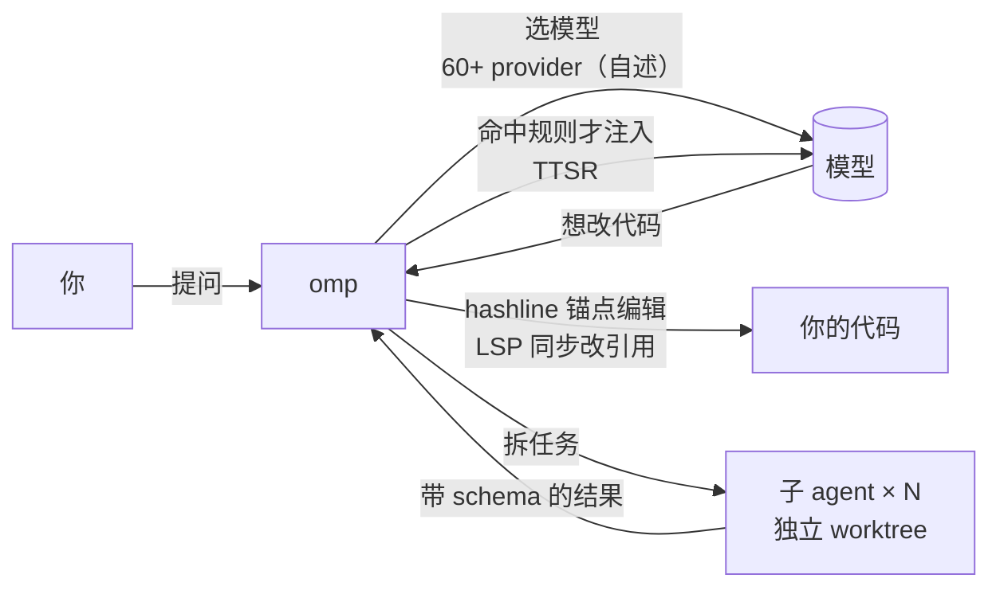

# Awesome omp (oh-my-pi)

[English](README.en.md) | 中文

> 把 **omp**（[can1357/oh-my-pi](https://github.com/can1357/oh-my-pi)）讲透的深研清单：先弄懂它的机制，再看逐条核实过的生态和 Pi 兼容性。给人读，也给 AI agent 当上下文。

**omp 是什么**：一个终端里的 AI coding agent，从 [Pi](https://github.com/earendil-works/pi) 分叉而来，把 LSP、调试器、语法级编辑和大量工具直接接进 agent。
**不是**：oh-my-posh（它的主题文件叫 `*.omp.json`）、npm 上的 `oh-my-pi` 包、OpenMP。

<!-- BEGIN GENERATED: stats --><!-- END GENERATED: stats -->

## 目录

- [只看 3 条](#只看-3-条)
- [30 秒看懂 omp](#30-秒看懂-omp)
- [精选](#精选)
- [常见误解](#常见误解)
- [深入阅读](#深入阅读)
- [收录规则](#收录规则)
- [与现有清单的区别](#与现有清单的区别)
- [给 AI agent](#给-ai-agent)
- [声明](#声明)

## 只看 3 条

<!-- BEGIN GENERATED: top3 -->
<!-- END GENERATED: top3 -->

## 30 秒看懂 omp

1. **Pi 是极简内核，omp 是全家桶。** 同样能写扩展，但 omp 自带 LSP、调试器、浏览器、子 agent、插件市场。
2. **它押注 harness 而不是模型。** 作者的论点：同一个模型，换编辑格式和工具设计，成功率会差很多（[why.md](docs/why.md)）。
3. **生态和 Pi 部分互通。** Pi 包常常能装上，但目录、API 版本不同，要逐个验证（[兼容矩阵](docs/pi-compat.md)）。

## 精选

每条一句「为什么值得看」。全量登记见 [docs/ecosystem.md](docs/ecosystem.md)。

<!-- BEGIN GENERATED: featured -->
<!-- END GENERATED: featured -->

## 常见误解

<!-- BEGIN GENERATED: misconceptions -->
<!-- END GENERATED: misconceptions -->

## 深入阅读

| 文档 | 内容 |
|---|---|
| [docs/deep-dive.md](docs/deep-dive.md) | 是什么、有什么用、怎么实现（架构图、hashline、TTSR、子 agent、扩展 API，带源码路径） |
| [docs/why.md](docs/why.md) | 为什么会有 omp；之前 vs 之后；社区支持与质疑；前景 |
| [docs/practice.md](docs/practice.md) | 安装、第一次运行、写扩展、做插件市场、装 Pi 包、信任与安全 |
| [docs/pi-compat.md](docs/pi-compat.md) | Pi 与 omp 兼容矩阵 |
| [docs/ecosystem.md](docs/ecosystem.md) | 全量生态登记（每条带证据、核实日期、稳定锚点） |
| [docs/timeline.md](docs/timeline.md) | 时间线 |
| [examples/](examples/) | 最小扩展、最小插件市场、离线测试脚本与 [RUNLOG](examples/RUNLOG.md) |
| [research/](research/) | 每轮调研笔记与原始出处 |

## 收录规则

**收**：omp 本体与官方文档；声明支持 omp 或经本仓库实测可用的扩展、插件、skills、主题、前端、编辑器集成；作者原文与第三方实践文章；公开讨论；中文社区资源；相邻清单。

**不收**：只支持 Pi 且没有在 omp 上验证过的包（去 Pi 清单找）；oh-my-posh、OpenMP 等同名项目；营销页；纯转载。

**门槛**（全部满足）：

1. 源码或文档公开可访问。
2. 有支持 omp 的正面证据：README / 描述里写明，或本仓库实测。
3. 近 180 天有提交或发布，未归档。
4. 自动导入的 GitHub 项目至少 5★，npm 包上月下载至少 300。

精选另需一句「为什么值得看」和至少一个一手来源。证据类型分 **已验证 / 自述 / 实测 / 推断** 四种，每条都标出。登记表的分类由关键词自动判定，可能有误，欢迎提 issue。

## 与现有清单的区别

| 清单 | 定位 | 本仓库补什么 |
|---|---|---|
| [shaftoe/awesome-pi-coding-agent](https://github.com/shaftoe/awesome-pi-coding-agent) | Pi 生态每日自动索引，LLM 分类，规模大 | 只看 omp；讲机制；每条带 omp 支持证据和核实日期 |
| [thevibeworks/awesome-pi-agent](https://github.com/thevibeworks/awesome-pi-agent) | Pi 生态人工策展，omp 是其中一节 | omp 专属的原理层、Pi 兼容矩阵、实测示例 |
| [bubbleptr/awesome-pi](https://github.com/bubbleptr/awesome-pi) | 中文 Pi Package 精选，不收 omp 生态 | omp 生态与中文资源 |

想看整个 Pi 生态，请去上面两份清单；本仓库只深挖 omp。调研过程见 [research/2026-10-21-prior-art.md](research/2026-10-21-prior-art.md)。

## 给 AI agent

- 入口：[llms.txt](llms.txt)；全量数据：[data/awesome-omp.json](data/awesome-omp.json)；字段定义：[AGENTS.md](AGENTS.md) 与 [data/schema.json](data/schema.json)。
- 每条都有 `id` 锚点，可直接链接 `docs/ecosystem.md#<id>`。
- 所有数字由脚本生成，不要手改。

## 贡献

见 [CONTRIBUTING.md](CONTRIBUTING.md)。新条目请用 issue 模板，附上支持 omp 的证据链接。

## 许可

[CC0-1.0](LICENSE)。

## 声明

本仓库在资料检索、信息分析和图表绘制中使用了 AI 辅助，由人工编辑校正并深度梳理。它主要服务于我个人的技术研究与实践，内容仅供参考。

文中的数据和状态可能存在延迟，请以原始出处为准，谨慎判断后再使用。

如有内容涉及侵权，请在 [Issues](https://github.com/hyeebeen/awesome-omp/issues) 留言，我会尽快核实并删除。
