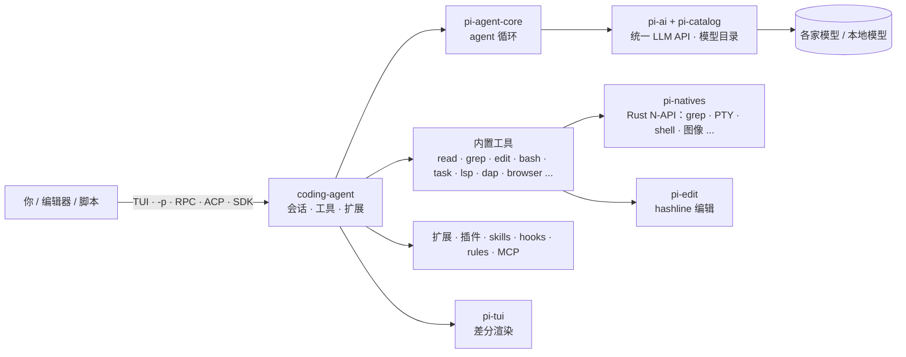
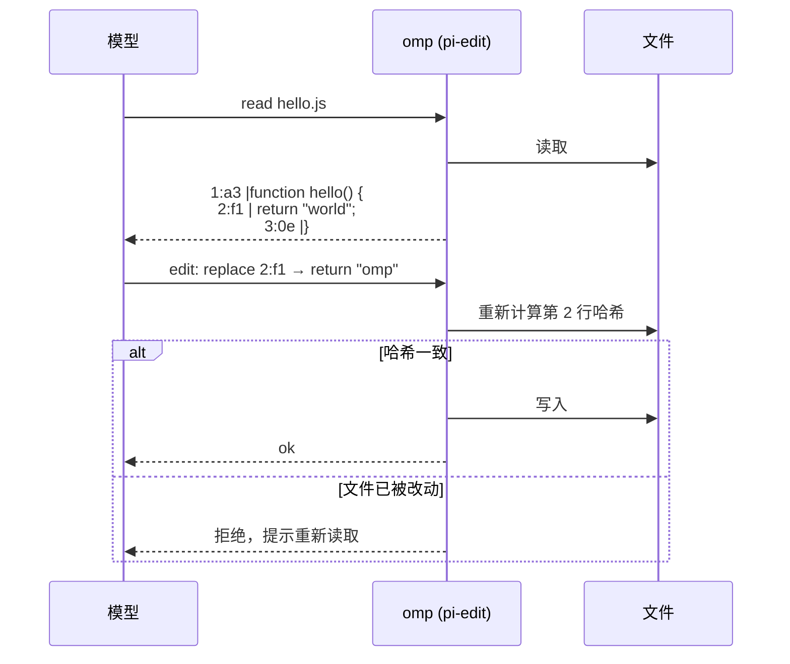
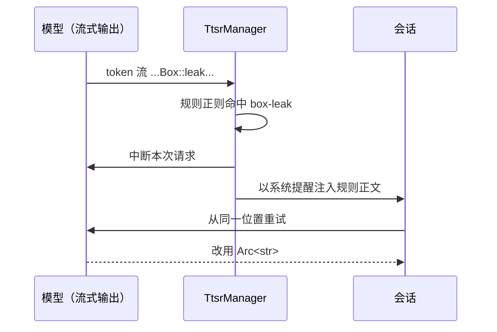
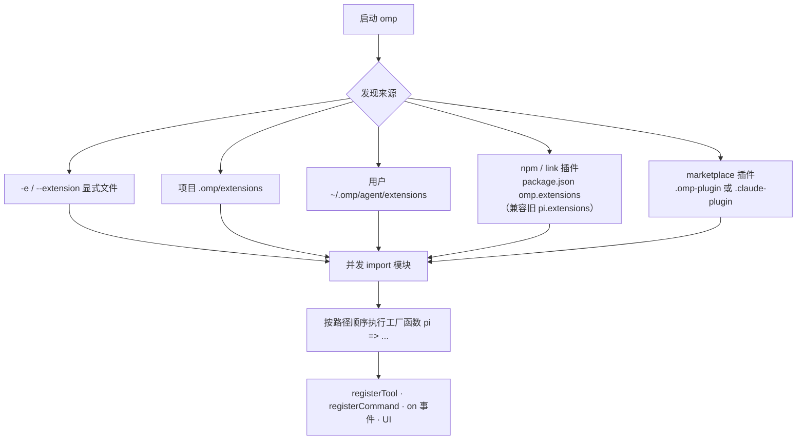

# omp 深度解读：是什么、有什么用、怎么实现、如何运用

> 核实日期 2026-10-21（Asia/Shanghai），对应 omp v18.12.5。版本号只写在 [时间线](timeline.md)；其它地方只写机制。
> 标「自述」的是项目自己的说法；标「推断」的是我们的判断。

## 1. 是什么

**一句话**：omp（oh-my-pi）是一个终端里的 AI coding agent。它从 Pi 分叉而来，把 IDE 的能力（LSP、调试器、语法级编辑）和大量工具直接接进 agent。

- Pi 的思路是**极简内核 + 用户自己扩展**；omp 的思路是**开箱全家桶**：README 原话是 "The Pi you love, with batteries included"（自述）。
- 仓库 [can1357/oh-my-pi](https://github.com/can1357/oh-my-pi/tree/main)，MIT，TypeScript + Bun，另有 Rust 原生层（`crates/`）。
- 命令名 `omp`，npm 包 `@oh-my-pi/pi-coding-agent`。不是 oh-my-posh，不是 npm 上的 `oh-my-pi` 包（见 [常见误解](../README.md#常见误解)）。

各包职责取自各自 package.json 的 description：
[pi-agent-core](https://github.com/can1357/oh-my-pi/tree/main/packages/agent)（通用 agent，状态管理）、
[pi-ai](https://github.com/can1357/oh-my-pi/tree/main/packages/ai)（统一 LLM API，自动发现模型）、
[pi-catalog](https://github.com/can1357/oh-my-pi/tree/main/packages/catalog)（模型目录）、
[pi-tui](https://github.com/can1357/oh-my-pi/tree/main/packages/tui)（差分渲染 TUI）、
[pi-natives](https://github.com/can1357/oh-my-pi/tree/main/packages/natives)（Rust 绑定：grep、PTY、shell、图像、剪贴板等）、
[snapcompact](https://github.com/can1357/oh-my-pi/tree/main/packages/snapcompact)（把上下文压成位图给视觉模型）、
[pi-mnemopi](https://github.com/can1357/oh-my-pi/tree/main/packages/mnemopi)（本地 SQLite 记忆）。

## 2. 有什么用（场景）

| 场景 | omp 怎么做 | 证据 |
|---|---|---|
| 改名、重构不漏引用 | 写文件走 LSP（如 `workspace/willRenameFiles`），re-export、别名一起改 | README §02（自述），[lsp-config.md](https://github.com/can1357/oh-my-pi/blob/main/docs/lsp-config.md) |
| 排查崩溃、卡死 | agent 直接挂 lldb / dlv / debugpy，单步、看帧 | README §03（自述），[src/dap/](https://github.com/can1357/oh-my-pi/tree/main/packages/coding-agent/src/dap) |
| 让模型别犯老错误 | TTSR：规则平时不占上下文，输出命中正则才中断并注入 | [ttsr-injection-lifecycle.md](https://github.com/can1357/oh-my-pi/blob/main/docs/ttsr-injection-lifecycle.md) |
| 大任务拆给多个 worker | `task` 工具派生子 agent，各自隔离 worktree，返回带 schema 的结果 | README §05（自述），[task-agent-discovery.md](https://github.com/can1357/oh-my-pi/blob/main/docs/task-agent-discovery.md) |
| 团队已有 Claude/Cursor 规则 | 首次运行自动读取 .claude、.cursor、.codex 等 8 种目录的规则、skills、MCP | README「Discovery」（自述） |
| 本地 / 自建模型 | `models.yml` 自定义 provider，模型角色（default、smol、slow、plan） | [models.md](https://github.com/can1357/oh-my-pi/blob/main/docs/models.md)，[doug.sh 实践](https://doug.sh/posts/oh-my-pi-custom-models/) |
| 在编辑器里用 | `omp acp` 作为 ACP server（如 Zed） | README §14，[src/modes/acp/](https://github.com/can1357/oh-my-pi/tree/main/packages/coding-agent/src/modes/acp) |

## 3. 怎么实现（关键机制）

### 3.1 hashline：按内容哈希编辑

问题：`apply_patch` 要求模型写对 diff 格式，`str_replace` 要求模型逐字复现旧文本。两者都依赖模型「复述」它看过的内容。

做法：读文件时每行带一个 2–3 字符的内容哈希；编辑时模型只引用「行号:哈希」作为锚点。文件变了，哈希对不上，编辑在落盘前被拒绝。

- 源码：[crates/pi-edit/src/modes/hashline/](https://github.com/can1357/oh-my-pi/tree/main/crates/pi-edit/src/modes/hashline)（parser、patcher、mismatch、recovery），语法 [hashline.lark](https://github.com/can1357/oh-my-pi/blob/main/crates/pi-edit/grammars/hashline.lark)。
- 效果（自述）：作者基准中 16 个模型有 14 个优于 patch；也有模型变差，并有用户反馈实际修复锚点耗轮次。见 [why.md](why.md#社区声音)。

### 3.2 TTSR：时间旅行的流式规则

- 会话创建时加载规则并分桶（`createAgentSession()` → `TtsrManager`）。实现：[session/ttsr-coordinator.ts](https://github.com/can1357/oh-my-pi/blob/main/packages/coding-agent/src/session/ttsr-coordinator.ts)，提示词模板在 [prompts/system/ttsr-*.md](https://github.com/can1357/oh-my-pi/tree/main/packages/coding-agent/src/prompts/system)。
- 好处：不在每轮都付规则的上下文成本；注入在压缩后保留（README §04，自述）。
- 代价（推断）：中断重试会多花一次请求，规则写得太宽会频繁打断。

### 3.3 子 agent（task）

- agent 定义来自 bundled / user / project 三个来源，按优先级合并；`main`、`sub` 是保留名；有 spawn 深度限制（[task-agent-discovery.md](https://github.com/can1357/oh-my-pi/blob/main/docs/task-agent-discovery.md)）。
- 实现：[src/task/](https://github.com/can1357/oh-my-pi/tree/main/packages/coding-agent/src/task)（executor.ts、structured-subagent.ts、spawn-policy.ts）。
- 子 agent 的结果是 schema 校验过的对象，父 agent 用 `agent://<id>/findings.0.path` 这类内部 URL 按路径取字段（README §17，自述；实现 [src/internal-urls/](https://github.com/can1357/oh-my-pi/tree/main/packages/coding-agent/src/internal-urls)）。

### 3.4 扩展 API 与插件

- 扩展是一个默认导出工厂函数的 TS/JS 模块：`export default function (pi: ExtensionAPI) { ... }`。可注册工具、斜杠命令、快捷键、事件处理、自定义渲染（[extensions.md](https://github.com/can1357/oh-my-pi/blob/main/docs/extensions.md)）。
- 运行时：[src/extensibility/extensions/](https://github.com/can1357/oh-my-pi/tree/main/packages/coding-agent/src/extensibility/extensions)（loader.ts、runner.ts、types.ts）。
- 插件市场：[src/extensibility/plugins/](https://github.com/can1357/oh-my-pi/tree/main/packages/coding-agent/src/extensibility/plugins)（installer.ts、manager.ts）。兼容 Claude Code 插件格式。
- Pi 兼容层：[legacy-pi-compat.ts](https://github.com/can1357/oh-my-pi/blob/main/packages/coding-agent/src/extensibility/plugins/legacy-pi-compat.ts) 把 `@mariozechner/*`、`@earendil-works/*` 导入别名到 omp 自己的包。细节见 [Pi 兼容矩阵](pi-compat.md)。
- 本仓库实测：最小扩展、最小 marketplace、Pi 包 pi-web-access 都能离线加载（[RUNLOG](../examples/RUNLOG.md)）。

### 3.5 入口与嵌入

| 入口 | 用途 | 文档 |
|---|---|---|
| 交互 TUI | 日常使用 | [tui.md](https://github.com/can1357/oh-my-pi/blob/main/docs/tui.md) |
| `omp -p` | 一次性任务 | [cli-reference.md](https://github.com/can1357/oh-my-pi/blob/main/docs/cli-reference.md) |
| `--mode rpc` | 任意语言通过 stdio NDJSON 驱动；先发 `ready` 帧 | [rpc.md](https://github.com/can1357/oh-my-pi/blob/main/docs/rpc.md) |
| `omp acp` | 编辑器（ACP 客户端） | README §14 |
| SDK | Node 内嵌 | [sdk.md](https://github.com/can1357/oh-my-pi/blob/main/docs/sdk.md) |

### 3.6 规范与协议接入

- MCP：[mcp-config.md](https://github.com/can1357/oh-my-pi/blob/main/docs/mcp-config.md) 等 4 篇。
- OSC 7501 程序状态协议：omp 是早期接入方之一，详见 [awesome-osc7501](https://github.com/hyeebeen/awesome-osc7501)。

## 4. 如何运用

最短路径见 [practice.md](practice.md)。三条建议：

1. 先装好再配 `models.yml` 或登录一个 provider。没有默认模型时 omp 会直接退出。
2. 打开陌生仓库前读 [信任与安全](practice.md#信任与安全)。
3. 想装 Pi 包，先查 [兼容矩阵](pi-compat.md)，再用 `omp install npm:<pkg>` 在隔离 profile 里试。

## 5. 空白（可贡献之处）

- Pi 包在 omp 上的兼容性没有系统数据。本仓库只实测了 1 个（pi-web-access）。
- hashline 和 TTSR 的效果只有作者自己的基准，没有找到第三方复现。
- omp² 的发布时间、扩展迁移路径都还没有公开说明。
- omp 与 Pi 主题格式是否互通未验证。
