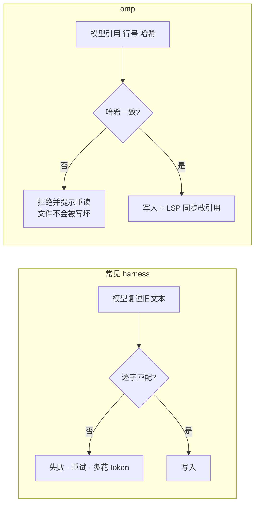

# 为什么会有 omp

## 一句话答案

作者认为：今天 coding agent 的很多失败不是模型不够聪明，而是 **harness**（包住模型的那层：工具格式、错误信息、状态管理）做得差。omp 就是在 Pi 的基础上，把这层做重、做深。

## 痛点：一个具体场景

你让 agent 改一个 400 行文件里的某一行。

- 用 `str_replace`：模型必须逐字写出旧代码，包括缩进。差一个空格就报「String to replace not found」，再试一次。
- 用 `apply_patch`：模型必须写对 diff 格式。作者基准里 Grok 4 的 patch 失败率 50.7%，GLM-4.7 是 46.2%（自述，[The harness problem](https://blog.can.ac/2026/02/12/the-harness-problem/)）。

失败一次，就多一轮请求、多一份 token，用户会觉得「这个模型不行」。

## 之前 vs 之后

同样的思路贯穿 omp：

| 问题 | 一般做法 | omp 做法 |
|---|---|---|
| 编辑失败率高 | 让模型复述 | hashline 锚点 |
| 规则占上下文 | 每轮都放进 system prompt | TTSR：命中才注入 |
| 子 agent 输出难用 | 返回大段文字 | 返回 schema 校验的对象 |
| 只能 print 调试 | 让模型加日志 | 直接挂调试器（DAP） |
| 迁移成本 | 写导入脚本 | 直接读 8 种已有规则格式 |

## 为什么这样设计

- **模型是参数，harness 才是变量**：omp 不绑定模型（自述 60+ provider），所以它是测试 harness 改进的好场地（作者原话大意，见 The harness problem）。
- **把复杂度留在 harness 里**：《The Harness Playbook》引用 Ousterhout「embrace suffering」：难题由模块作者解决，别让每个调用者各自背一份（[原文](https://stencil.so/blog/harness-playbook)）。
- **继承 Pi 的可扩展性**：扩展、skills、hooks 都还在；再加上 Claude Code 插件市场兼容。

## 社区声音

| 立场 | 谁 | 说了什么 | 出处 |
|---|---|---|---|
| 支持 | rurban（HN） | 「Currently the very best」 | [HN](https://news.ycombinator.com/item?id=48995761) |
| 支持 | explodes（HN） | 替代 OpenCode 搭配 Z.ai，上手很简单，像 power-user 版 TUI agent | [HN](https://news.ycombinator.com/item?id=49022642) |
| 支持 | Doug Calobrisi | 用 omp + 本地 Qwen 在两张 3090 上跑，并写了配置指南 | [doug.sh](https://doug.sh/posts/tuning-a-local-coding-agent-oh-my-pi/) |
| 质疑 | localroast（HN） | 功能多但缺少实证；hash 锚点编辑实际中让模型花更多轮修复 | [HN](https://news.ycombinator.com/item?id=49545358) |
| 质疑 | riedel（HN） | 缺少消融实验，很难知道每个功能的效果 | [HN](https://news.ycombinator.com/item?id=49546980) |
| 质疑 | elikoga（HN） | 喜欢用，但感觉作者在 CI 里的基准不够严谨 | [HN](https://news.ycombinator.com/item?id=48999727) |
| 担忧 | hahn-kev（HN） | 用订阅账号 OAuth 登录时，多家提示只接受官方工具，担心被封号 | [HN](https://news.ycombinator.com/item?id=49007232) |
| 观望 | coffeeindex（HN） | 光说能扩展说服不了我，开箱体验如何？ | [HN](https://news.ycombinator.com/item?id=49549160) |

身份只取自公开用户名；我们没有核实这些人的背景。

## 现实意义

- **对用户**：同一个模型，换 harness 可能体验差很多。选 agent 时，模型之外还要看编辑格式、工具设计、规则机制。
- **对工具作者**：hashline、TTSR、结构化子 agent 输出都是可借鉴的设计，不限于 omp。
- **对生态**：omp 兼容 Claude Code 插件格式、读取多家规则目录，降低了在多个 agent 之间切换的成本。

## 前景（整节为推断）

- omp 迭代极快（几乎每天一个 patch release），功能会继续增加；稳定性和文档同步是长期挑战。
- 作者已公布 omp²：会话变成一个「物化的 DOM」、工具执行是可取消的状态流、扩展改用 Python。如果落地，现有 TypeScript 扩展可能需要迁移。
- 可观察信号：omp² 首个公开版本；扩展 API 的弃用公告；第三方对 hashline 的独立复现；Pi 与 omp 的同步点是否更新。
